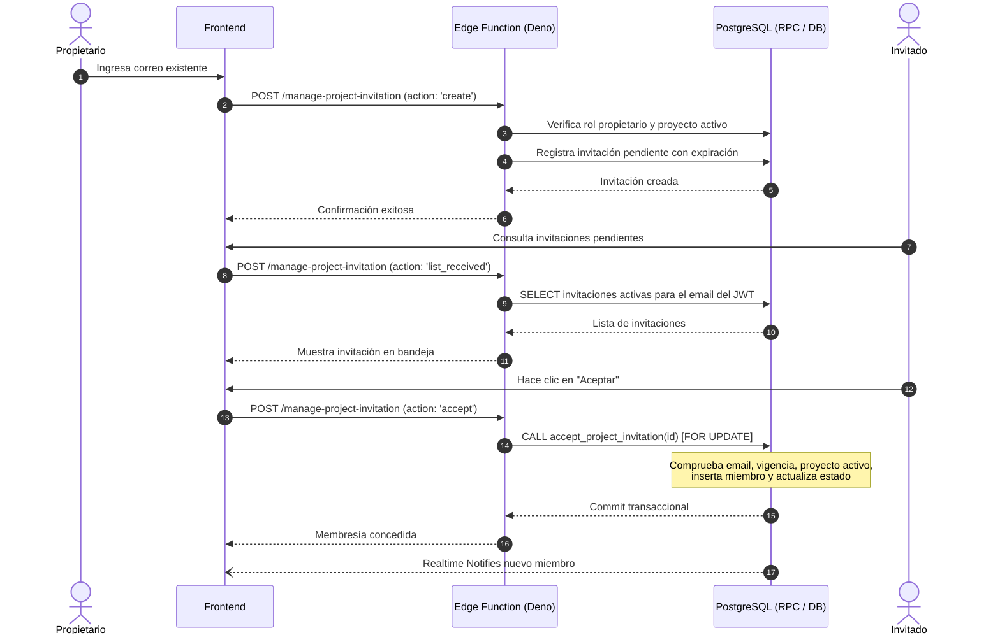

# Arquitectura del Sistema — SyncBoard
## Sistemas Interactivos Distribuidos

---

## 1. Visión General de la Arquitectura

**SyncBoard** adopta un patrón de **Arquitectura Distribuida Basada en Eventos y BaaS (Backend-as-a-Service)** centrado en PostgreSQL como fuente canónica de verdad.

```
                           +----------------------------------------+
                           |          Navegador Web (SPA)           |
                           |   React 18 + TypeScript + Vite + CSS   |
                           +----------------------------------------+
                             /            |                       ^
                 Auth & CRUD |            | Invocación Edge        | Supabase Realtime
                     (HTTPS) |            | Function (HTTPS)       | (WebSocket PostgreSQL
                             |            |                        |  Change Events)
                             v            v                        |
            +---------------------+  +------------------------+    |
            |    Supabase Auth    |  |  Supabase Edge Runtime |    |
            |  (JWT & Sessions)   |  |   (Deno TypeScript)    |    |
            +---------------------+  +------------------------+    |
                       |                          |                |
                       +------------+-------------+                |
                                    |                              |
                                    v                              |
                    +------------------------------------+         |
                    |         PostgreSQL 15 Core         |---------+
                    |  - Row Level Security (RLS)        |
                    |  - Foreign Key Constraints         |
                    |  - Stored Procedures (Atomic RPCs) |
                    |  - WAL Change Data Capture (CDC)   |
                    +------------------------------------+
```

---

## 2. Responsabilidades por Componente

### 2.1. Frontend (React 18 + Vite + TypeScript)
- **Presentación e Interacción**: Renderizado del tablero Kanban, tarjetas de tarea, filtros y estados de carga/error.
- **Gestión de Sesión**: Almacena de forma segura el JWT emitido por Supabase Auth, restaurándolo al refrescar la página.
- **Suscripciones Reactivas**: Establece canales Realtime sobre el proyecto activo y actualiza el estado local cuando recibe notificaciones de PostgreSQL.
- **Desacoplamiento**: No contiene secretos de servidor, cadenas de conexión directas ni lógica de autorización crítica (la cual reside en PostgreSQL RLS).

### 2.2. Supabase Auth
- Manejo de ciclo de vida de usuarios (registro, login, restablecimiento de contraseña).
- Emisión y renovación de JSON Web Tokens (JWT) con claims del usuario (`sub`, `email`).
- Integración nativa con PostgreSQL mediante `auth.uid()` y `auth.jwt()`.

### 2.3. PostgreSQL Core (La Fuente de Verdad)
- **Integridad Referencial Estricta**: Relaciones de clave foránea compuestas, como `(project_id, assignee_id) -> project_members(project_id, user_id)`, asegurando a nivel de base de datos que una tarea solo pueda ser asignada a un miembro del mismo proyecto.
- **Row Level Security (RLS)**: Aplica control de acceso multi-inquilino a nivel de fila. Los clientes solo pueden consultar o mutar filas si las políticas SQL lo autorizan explícitamente.
- **Operaciones Transaccionales (RPCs)**:
  - `create_project_with_owner`: Crea el proyecto, asigna la membresía de propietario y registra el evento de actividad en una única transacción atómica.
  - `accept_project_invitation`: Bloquea la fila con `FOR UPDATE`, valida expiración, estado pendiente, identidad del correo, inserta membresía y actualiza el estado de la invitación.
  - `soft_delete_project`: Marca `deleted_at`, revoca invitaciones pendientes y registra la auditoría.
- **Eliminación Lógica**: Preserva integridad histórica sin destruir tareas ni registros de auditoría.

### 2.4. Supabase Edge Functions (`manage-project-invitation`)
- Ejecutadas en el runtime Deno en el borde de la red.
- Valida identidades autenticadas, evita llamadas directas no autorizadas e interactúa con el motor de base de datos para operaciones críticas de membresía e invitaciones.

### 2.5. Supabase Realtime
- Monitorea el Write-Ahead Log (WAL) de PostgreSQL mediante Logical Replication.
- Publica eventos `INSERT`, `UPDATE` y `DELETE` a clientes conectados que posean permisos de lectura en las tablas correspondientes.

---

## 3. Flujos de Ejecución y Comunicación

### 3.1. Flujo de Creación y Asignación de Tareas
1. El usuario interactúa con el formulario en React.
2. La mutación se envía directamente mediante el cliente oficial de Supabase.
3. PostgreSQL evalúa las políticas RLS: confirma que el usuario pertenece al proyecto activo (`deleted_at IS NULL`).
4. La restricción de clave foránea valida que el responsable asignado pertenece al proyecto.
5. Si la inserción es exitosa, PostgreSQL genera el registro.
6. Supabase Realtime emite el evento `INSERT` a todos los clientes suscritos al canal del proyecto.
7. Los tableros Kanban de los integrantes reflejan la nueva tarea en tiempo real.

### 3.2. Flujo de Invitación y Aceptación Transaccional


---

## 4. Decisiones de Diseño y Limitaciones Conscientes

1. **Sin Redux / Zustand**: La gestión de estado global se resuelve con Context API de React y el estado de Supabase. Esto evita sobreingeniería y facilita el estudio académico del código.
2. **Sin WebSocket artesanal**: Supabase Realtime abstrae la capa de conectividad distribuyendo directamente los cambios de PostgreSQL.
3. **Soft Delete en Proyectos**: La columna `deleted_at` garantiza que las relaciones históricas, tareas y logs no queden huérfanos.
4. **Validación de Invitaciones en Servidor**: El destinatario debe coincidir exactamente con el correo verificado en Supabase Auth, previniendo suplantaciones.
