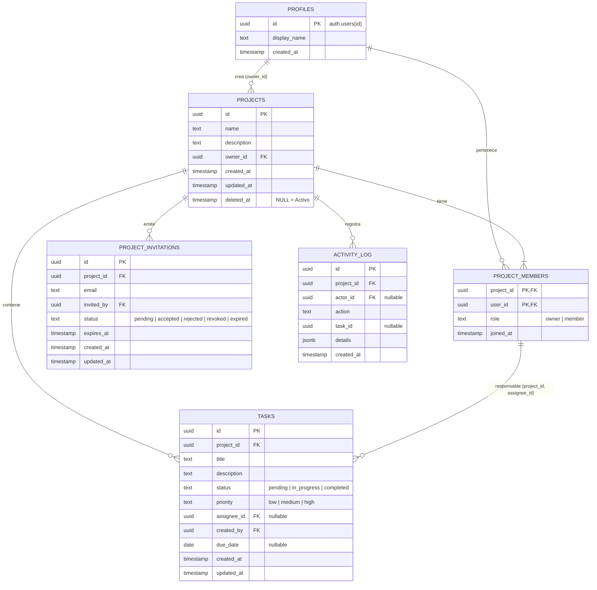

# Modelo de Datos Relacional y Seguridad — SyncBoard

## 1. Diagrama Entidad-Relación



---

## 2. Detalle de Entidades y Restricciones

### 2.1. `profiles`
- **Llave Primaria**: `id UUID REFERENCES auth.users(id) ON DELETE CASCADE`.
- **Campos**:
  - `display_name TEXT NOT NULL`
  - `created_at TIMESTAMPTZ DEFAULT now()`
- **Comportamiento**: Se genera automáticamente mediante el trigger `on_auth_user_created` cuando un usuario se registra en `auth.users`.

### 2.2. `projects`
- **Llave Primaria**: `id UUID DEFAULT gen_random_uuid()`.
- **Restricciones**:
  - `CHECK (char_length(trim(name)) > 0)`
  - `owner_id UUID NOT NULL REFERENCES auth.users(id) ON DELETE RESTRICT`
  - `deleted_at TIMESTAMPTZ DEFAULT NULL` (Marca de tiempo para eliminación lógica).
- **Regla de Negocio**: Solo los proyectos donde `deleted_at IS NULL` son considerados activos en consultas normales.

### 2.3. `project_members`
- **Llave Primaria Compuesta**: `(project_id, user_id)`.
- **Restricciones**:
  - `role TEXT NOT NULL CHECK (role IN ('owner', 'member'))`
  - Claves foráneas con borrado en cascada si el proyecto o usuario es eliminado físicamente.

### 2.4. `project_invitations`
- **Llave Primaria**: `id UUID DEFAULT gen_random_uuid()`.
- **Restricciones**:
  - `email TEXT NOT NULL CHECK (position('@' in email) > 1)`
  - `status TEXT NOT NULL CHECK (status IN ('pending', 'accepted', 'rejected', 'revoked', 'expired'))`
  - `expires_at TIMESTAMPTZ DEFAULT now() + INTERVAL '7 days'`
- **Índice Único Parcial**:
  `CREATE UNIQUE INDEX idx_unique_pending_invitation ON project_invitations(project_id, lower(email)) WHERE status = 'pending';`
  Impide generar múltiples invitaciones activas duplicadas hacia la misma cuenta en el mismo proyecto.

### 2.5. `tasks`
- **Llave Primaria**: `id UUID DEFAULT gen_random_uuid()`.
- **Restricciones de Dominio**:
  - `status TEXT NOT NULL CHECK (status IN ('pending', 'in_progress', 'completed'))`
  - `priority TEXT NOT NULL CHECK (priority IN ('low', 'medium', 'high'))`
- **Integridad Referencial Cruzada**:
  ```sql
  CONSTRAINT fk_tasks_assignee_membership
      FOREIGN KEY (project_id, assignee_id)
      REFERENCES public.project_members(project_id, user_id)
      ON DELETE SET NULL
  ```
  Garantiza a nivel de motor SQL que una tarea no puede tener asignada a una persona que no pertenezca explícitamente al mismo proyecto.

### 2.6. `activity_log`
- **Llave Primaria**: `id UUID DEFAULT gen_random_uuid()`.
- **Campos**:
  - `project_id UUID NOT NULL REFERENCES public.projects(id) ON DELETE CASCADE`
  - `actor_id UUID REFERENCES auth.users(id) ON DELETE SET NULL`
  - `action TEXT NOT NULL`
  - `task_id UUID NULL`
  - `details JSONB NOT NULL DEFAULT '{}'::jsonb`
  - `created_at TIMESTAMPTZ DEFAULT now()`
- **Conservación**: Permite auditoría histórica inmutable de cambios de estado, creaciones y membresías.

---

## 3. Matriz de Autorización (Row Level Security - RLS)

| Tabla | Operación | Regla RLS | Roles Permitidos |
|---|---|---|---|
| `profiles` | SELECT | `true` (autenticados) | Todos los usuarios autenticados |
| `profiles` | UPDATE | `auth.uid() = id` | Únicamente el propio usuario |
| `projects` | SELECT | `deleted_at IS NULL AND is_project_member(id, auth.uid())` | Miembros del proyecto |
| `projects` | UPDATE | `deleted_at IS NULL AND owner_id = auth.uid()` | Propietario del proyecto |
| `project_members` | SELECT | `is_project_member(project_id, auth.uid())` | Miembros del proyecto |
| `project_members` | DELETE | `is_project_owner(project_id, auth.uid()) AND user_id <> auth.uid()` | Propietario (no auto-eliminación) |
| `project_invitations` | SELECT | `lower(email) = lower(auth.jwt()->>'email') OR is_project_owner(...)` | Destinatario o Propietario |
| `project_invitations` | INSERT | `is_project_owner(project_id, auth.uid())` | Propietario del proyecto |
| `tasks` | ALL | `is_project_member(project_id, auth.uid())` | Todos los miembros de proyectos activos |
| `activity_log` | SELECT | `is_project_member(project_id, auth.uid())` | Miembros del proyecto activo |
